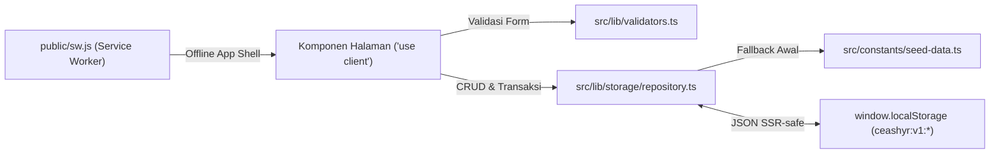

# Arsitektur Kode, PWA & Local-First Repository

Dokumen ini menjelaskan struktur folder proyek `ceashyr-pwa` serta antarmuka fungsi di `src/lib/` agar Gemini Hydrogen dapat langsung memanggil fungsi yang ada tanpa menulis ulang logika penyimpanan.

---

## 1. Struktur Folder Initial Commit

```text
ceashyr/
├── docs/                          # Dokumentasi proyek & panduan task Gemini Hydrogen
│   ├── 00-INDEX-FOR-HYDROGEN.md
│   ├── 01-PROJECT-OVERVIEW.md
│   ├── 02-ARCHITECTURE-AND-PWA.md
│   ├── 03-DESIGN-SYSTEM-FIGMA.md
│   ├── 04-USER-FLOWS-AND-PROTOTYPE.md
│   └── tasks/
│       ├── TASK-BOARD-CHECKLIST.md
│       ├── T-01-US04-AUTH-AND-ROLES.md
│       ├── T-02-US01-PRODUCTS-MANAGEMENT.md
│       ├── T-03-US05-SALES-POS.md
│       ├── T-04-US16-OCR-PAPER-REPORT.md
│       └── T-05-MOBILE-RESPONSIVE-PWA.md
├── public/
│   ├── manifest.json              # Web App Manifest (PWA installable di Tablet)
│   ├── sw.js                      # Service Worker offline-first shell caching
│   ├── icons/
│   │   ├── icon-192.svg
│   │   ├── icon-512.svg
│   │   └── avatar-default.svg
│   └── images/
│       └── login-canteen-illustration.png
├── src/
│   ├── app/                       # Next.js App Router pages
│   │   ├── globals.css
│   │   ├── layout.tsx             # Root font Inter, metadata PWA, PwaRegistrar
│   │   ├── page.tsx               # Launchpad & reset seed data
│   │   ├── login/page.tsx         # US-04 (H-01, H-02)
│   │   ├── register/page.tsx      # US-04 Register & Lupa Sandi (H-01)
│   │   ├── ketua/page.tsx         # US-04 Beranda Ketua KWU (H-03)
│   │   ├── produk/page.tsx        # US-01 Daftar, Detail & Form Tambah (H-04..H-06)
│   │   ├── kasir/page.tsx         # US-05 & US-06 Pencatatan Penjualan (H-07..H-08)
│   │   └── rekap-kertas/page.tsx  # US-16 Foto & OCR Offline Queue (H-09..H-11)
│   ├── components/
│   │   ├── layout/
│   │   │   ├── AppShell.tsx       # Sidebar 84px tablet + bottom nav <768px + header role
│   │   │   └── SidebarIcons.tsx   # SVG ikon resmi dari Figma 1331:4912
│   │   ├── pwa/
│   │   │   └── PwaRegistrar.tsx
│   │   └── ui/
│   │       └── ProductCard.tsx    # Kotak produk horizontal #465947 (3 kolom)
│   ├── constants/
│   │   ├── design-tokens.ts
│   │   └── seed-data.ts
│   ├── lib/
│   │   ├── formatters.ts
│   │   ├── validators.ts
│   │   └── storage/
│   │       ├── storage-keys.ts
│   │       └── repository.ts
│   └── types/
│       └── index.ts
├── next.config.mjs
├── package.json
├── postcss.config.mjs
├── tailwind.config.ts
└── tsconfig.json
```

---

## 2. Aliran Data & Arsitektur Local-First



### Kunci `localStorage` (`src/lib/storage/storage-keys.ts`)

| Konstanta | Key `localStorage` | Isi Data |
| :--- | :--- | :--- |
| `STORAGE_KEYS.SESSION` | `ceashyr:v1:session` | `SessionState \| null` |
| `STORAGE_KEYS.EXTRA_ACCOUNTS` | `ceashyr:v1:extra_accounts` | `UserAccount[]` hasil `/register` |
| `STORAGE_KEYS.PRODUCTS` | `ceashyr:v1:products` | `Product[]` (default 3 item seed) |
| `STORAGE_KEYS.TRANSACTIONS` | `ceashyr:v1:transactions` | `Transaction[]` |
| `STORAGE_KEYS.OCR_QUEUE` | `ceashyr:v1:ocr_queue` | `OcrReportRecord[]` status `queued_offline` |
| `STORAGE_KEYS.OCR_REPORTS` | `ceashyr:v1:ocr_reports` | `OcrReportRecord[]` status `saved` |

---

## 3. Referensi API Repository (`src/lib/storage/repository.ts`)

| Fungsi | Parameter | Nilai Kembalian | Dipakai di Task |
| :--- | :--- | :--- | :--- |
| `getSession()` | `-` | `SessionState \| null` | `H-01`, `H-03`, `H-04` |
| `login(email, password)` | `string, string` | `{ ok: true, session, redirectPath } \| { ok: false, fieldErrors?, error }` | `H-01`, `H-02` |
| `registerDemoAccount(email, password, role?)` | `string, string, UserRole` | `{ ok: true, account } \| { ok: false, error }` | `H-01` |
| `switchRole(targetRole)` | `'ketua_kwu' \| 'pengelola'` | `SessionState` | `H-04` |
| `logout()` | `-` | `void` | `H-01`..`H-11` |
| `getProducts()` | `-` | `Product[]` | `H-03`..`H-09` |
| `addProduct(input)` | `{ name, price, stock }` | `{ ok: true, product, products } \| { ok: false, errors }` | `H-05`, `H-06` |
| `getTransactions()` | `-` | `Transaction[]` | `H-03`, `H-08` |
| `createTransaction(items, cashierEmail?)` | `CartItem[], string` | `{ ok: true, transaction, products } \| { ok: false, error }` | `H-08` |
| `getOcrQueue()` | `-` | `OcrReportRecord[]` | `H-11` |
| `getOcrReports()` | `-` | `OcrReportRecord[]` | `H-03`, `H-10`, `H-11` |
| `enqueueOfflineOcr(fileName, presetKey?, imagePreviewUrl?)` | `string, string?, string?` | `OcrReportRecord` | `H-11` |
| `processOcrQueue(recordId?)` | `string?` | `OcrReportRecord[]` (sisa antrean) | `H-11` |
| `saveDigitalOcrReport(items, fileName, imagePreviewUrl?)` | `OcrExtractedItem[], string, string?` | `OcrReportRecord` | `H-10` |
| `resetAllDataToSeed()` | `-` | `void` | Launchpad & QA |

---

## 4. Konfigurasi PWA (`public/manifest.json` & `public/sw.js`)

1. **Installable di Tablet**: `display: "standalone"`, `orientation: "any"`, `start_url: "/login"`.
2. **Offline App Shell**: `public/sw.js` men-cache rute `/`, `/login`, `/register`, `/ketua`, `/produk`, `/kasir`, `/rekap-kertas` saat install, dan melayani request navigasi dengan strategi *network-first fallback to cache*.
3. **Pendaftaran Otomatis**: `src/components/pwa/PwaRegistrar.tsx` dimuat di `src/app/layout.tsx`.
4. **Indikator Online/Offline**: `AppShell` otomatis membaca `navigator.onLine` serta event `online`/`offline` dan menampilkan lencana status di kanan atas (`PWA Terhubung` vs `Mode Offline Lokal`).
