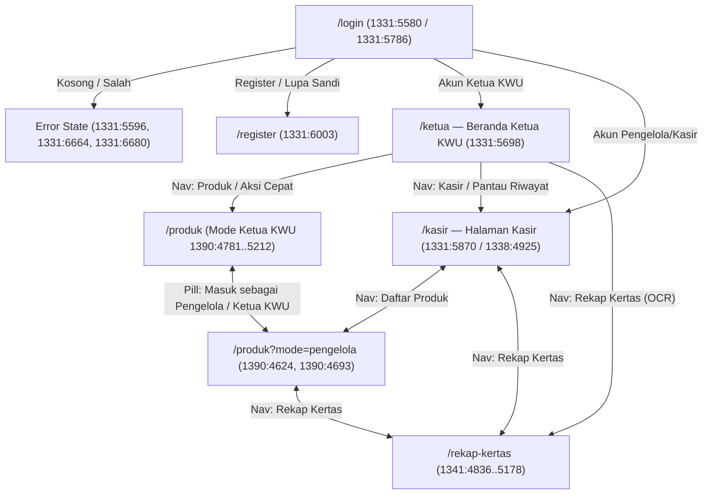

# Peta Flow & Interaksi Prototipe Figma (`1331:4912`)

Halaman `⭐️ Templates (Copy)` (`1331:4912`) memiliki **8 Section**, **34 Frame (`1280×800`)**, **7 Flow Starting Points**, dan **174 interaksi prototipe `ON_CLICK`** tanpa link terputus. Dokumen ini menjadi peta rujukan lengkap bagi Gemini Hydrogen.

---

## 1. Daftar 7 Flow Starting Points

| Nama Flow di Figma | Node Awal | Route Web | User Story |
| :--- | :---: | :--- | :---: |
| `US-04: Login & Peran Ketua KWU` | `1331:5580` | `/login` -> `/ketua` | `US-04` |
| `US-04: Error Login (Salah/Kosong)` | `1331:5596` | `/login` (validasi error) | `US-04` |
| `US-04: Login & Peran Kasir` | `1331:5786` | `/login` -> `/kasir` | `US-04` |
| `US-01: Daftar Produk (Pengelola)` | `1390:4624` | `/produk?mode=pengelola` | `US-01` |
| `US-01: Tambah Produk (Ketua KWU)` | `1390:4781` | `/produk` | `US-01` |
| `US-05: Pencatatan Penjualan` | `1338:4925` | `/kasir` | `US-05`, `US-06` |
| `US-16: Rekap Foto Laporan (OCR)` | `1341:4836` | `/rekap-kertas` | `US-16` |

---

## 2. Diagram Alur Navigasi Lintas Peran & Fitur

---

## 3. Rincian State per Section Figma

### A. Login & Error Negatif (`1331:5579`, `1387:4827`, `1331:5785`, `1331:6003`)
- **Login Ketua KWU (`1331:5579`)**:
  - `1331:5580` (Kosong) -> klik Email -> `1331:5622` (Terisi `ketuakwu@gmail.com`) -> klik Password -> `1331:5638` -> klik `Login` -> `1331:5698` (`/ketua`).
- **Error Negatif (`1387:4827`)**:
  - `1331:5596`: Submit form kosong -> border merah + `"Please Enter Email Address!"` & `"Please Enter Password!"`.
  - `1331:6664`: Isi akun salah (`salah@gmail.com`, `salah123`).
  - `1331:6680`: Tampilkan banner merah `"Email atau kata sandi salah! Periksa kembali akun Anda."`.
- **Login Kasir (`1331:5785`)**:
  - `1331:5786` -> `1331:5838` (`kasir@gmail.com`) -> `1331:5854` -> `1331:5870` (`/kasir`).
  - `1331:5947` (`Uji Pembagian Peran (Akses Terbatas Kasir)`): Kasir masuk ke daftar produk **Mode Lihat** tanpa akses tambah/ubah produk.
- **Register & Forgot Password (`1331:6003`)**:
  - Register (`1331:6004`) -> Verify Code (`1331:6065`) -> Login.
  - Forgot Password (`1331:6033`) -> Verify Code (`1331:6046`) -> Ganti Password (`1331:6019`) -> Login.

### B. US-1(Tambah Produk) — Pengelola (`1390:4621`) & Ketua KWU (`1331:6084`)
- **Mode Pengelola (`1390:4621`)**:
  - `P1` (`1390:4624`): 3 kotak produk + banner akses terbatas + pill `Mode Pengelola • Hanya Lihat`.
  - `P2` (`1390:4693`): Klik `Air Mineral 600 ml` -> panel kanan `Detail Produk` (`Rp4.000`, `15 unit`, hak akses Lihat Saja). Tombol `✕` kembali ke `P1`.
- **Mode Ketua KWU (`1331:6084`)**:
  - `K1` (`1390:4781`): Daftar 3 produk + tombol `+ Tambah Produk`.
  - `K2` (`1390:4854`): Klik `Air Mineral 600 ml` -> panel kanan `Detail Produk` + CTA `+ Tambah Produk Baru`.
  - `K3` (`1390:4946`): Form kosong dengan placeholder (`Contoh: Air Mineral 600 ml`, `3000`, `Jumlah barang yang ada sekarang`) + panel kanan `Pratinjau Kartu Produk`.
  - `K4` (`1390:5033`): Form terisi valid (`Roti Cokelat`, `5000`, `25`), border hijau + preview badge `Siap Simpan`.
  - `K5` (`1390:5120`): Submit kosong atau harga `<= 0` / stok `< 1` -> alert merah + pesan error per field.
  - `K6` (`1390:5212`): Klik `Simpan` pada data valid -> banner hijau sukses + grid 3 kolom menampilkan `4 produk dijual di kantin` dengan `Roti Cokelat` berlabel `BARU` di posisi pertama.

### C. US-05 Pencatatan Penjualan (`1331:6270`)
- `1338:4925`: Keranjang kosong (`0 Item`, `Rp 0`), 3 kartu produk berlabel `+ Tambah`.
- `1338:5007`: Pilih `Air Mineral 600 ml` -> label kartu berubah `Dipilih (1)`, muncul di `Keranjang Transaksi (1 Item)` dengan stepper `− 1 +`, total `Rp 4.000`.
- `1338:5097`: Beberapa item + ubah qty (`2 × Rp4.000 + 1 × Rp2.500 + 3 × Rp1.000 = Rp 13.500` untuk `6 item`).
- `1338:5211`: Klik `Simpan Penjualan` -> stok di 3 kartu produk otomatis berkurang (`Air Mineral: 13`, `Bang-Bang: 9`, `Chocolatas: 17`), tampil `Nota Transaksi Tersimpan` (`TRX-0001`, tombol `Catat Penjualan Baru`).

### D. US-16 Rekap Foto Laporan OCR (`1331:6426`)
- `1341:4836`: Empty state (`Ambil Foto`, `Pilih Galeri`, preview katalog `0 pcs`).
- `1341:4923`: Foto terpilih siap diproses -> tombol `Baca Teks Foto (OCR)` atau `Simpan ke Antrean Offline (Jika WiFi Bermasalah)`.
- `1341:5010`: Hasil OCR (`Air Mineral 600 ml: 6 pcs`, `Bang-Bang: 4 pcs`, `Chocolatas: 5 pcs` = `15 item`, `Rp 39.000`) + panel `Koreksi & Simpan Rekap Digital`.
- `1341:5098`: Antrean Offline (`laporan-pagi-17nov.jpg`, `laporan-siang-17nov.jpg`), tombol `Proses Sekarang` per item atau `Proses Semua Antrean`.
- `1341:5178`: Rekap tersimpan (`RKP-0001`), rincian hasil uji 3 sampel foto, tombol `Unggah Foto Laporan Baru`.
